# Actividad 2.7: Depuración de Código (Broken Code)
## Nivel 1 – Primeros pasos en depuración

---

## Introducción

En esta actividad se identifican, analizan y corrigen errores en distintos fragmentos de código JavaScript mediante el uso de herramientas de depuración (breakpoints, inspección de variables en el panel *Scope*, *Watch*, *Call Stack* y avance paso a paso con *Step Into* / *Step Over*).

Para cada ejercicio se documenta:
- **Dónde está el error**: Línea o elemento causante del fallo.
- **Tipo de error**: Sintáctico, lógico o en tiempo de ejecución (*Runtime / ReferenceError*).
- **Cómo corregirlo**: Solución explicada para resolver el comportamiento anómalo.
- **Código corregido**: Enlace al archivo correspondiente en la carpeta `src/`.
- **Evidencias de depuración**:
  - **Captura 1 (Ejecución)**: Resultado o mensaje de error arrojado por la consola al ejecutar el programa.
  - **Captura 2 (Breakpoint)**: Ejecución pausada en el punto de interrupción adecuado, inspeccionando el estado de las variables y el flujo de control.

---

## Ejercicio 1: Variable inexistente

* **Dónde está el error:** En la llamada a `console.log`, donde se intenta concatenar e imprimir la variable `reslt`.
* **Tipo de error:** Error en tiempo de ejecución (*ReferenceError: reslt is not defined*) provocado por un fallo tipográfico (*typo*).
* **Cómo corregirlo:** Sustituir el identificador incorrecto `reslt` por la variable que fue declarada previamente: `result`.
* **Código corregido:** [ejercicio1.js](src/ejercicio1.js)

### Evidencias de depuración

#### Ejecución del código con error
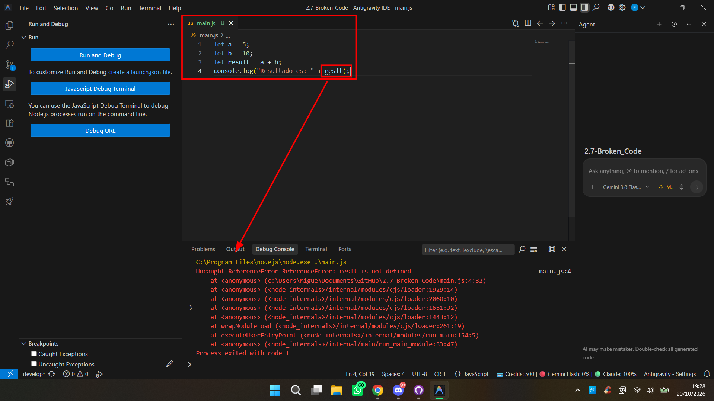

#### Depuración con Breakpoint e inspección de variables
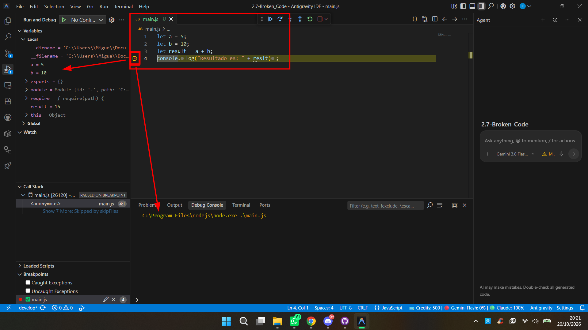

---

## Ejercicio 2: Comparaciones sospechosas

* **Dónde está el error:** En la condición de la estructura condicional `if (edad => 18)`. La secuencia `=>` no representa el operador relacional de mayor o igual, sino la definición de una función flecha (*arrow function*). Al evaluar una función en un contexto condicional, JavaScript la interpreta como un valor verdadero (*truthy*), ejecutando siempre la primera rama sin importar la edad.
* **Tipo de error:** Error lógico (sintaxis no pretendida que altera la lógica de comparación).
* **Cómo corregirlo:** Invertir el orden de los caracteres para utilizar el operador de comparación relacional correcto: `>=` (`edad >= 18`).
* **Código corregido:** [ejercicio2.js](src/ejercicio2.js)

### Evidencias de depuración

#### Ejecución del código con error
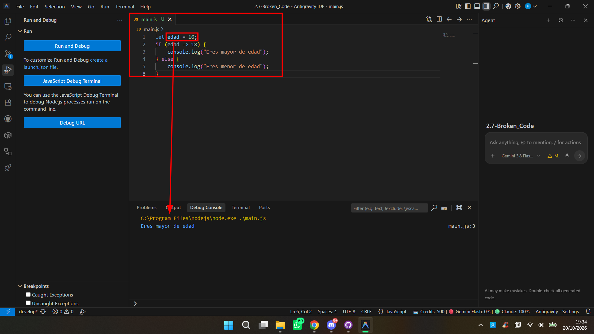

#### Depuración con Breakpoint e inspección de variables
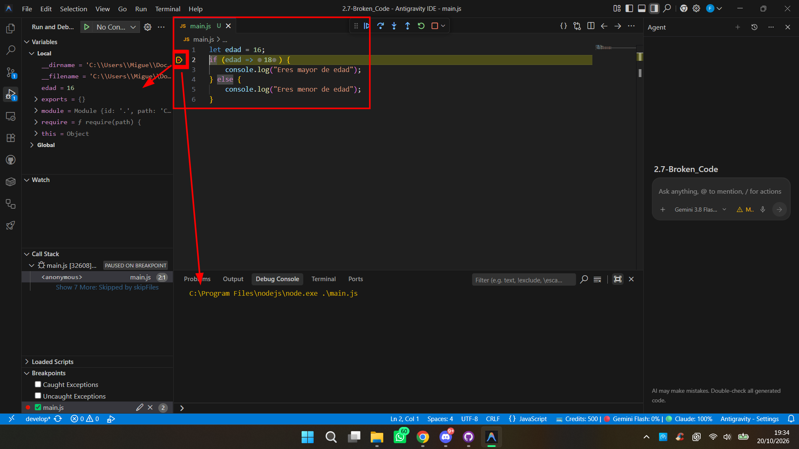

---

## Ejercicio 3: Return of the Jedi

* **Dónde está el error:** Dentro del cuerpo de la función `multiplicar`. La instrucción de retorno `return ofthejedi;` se encuentra comentada, por lo que la función finaliza sin devolver nada explícitamente, asignando por defecto el valor `undefined` a la variable `total`.
* **Tipo de error:** Error lógico (omisión de valor de retorno).
* **Cómo corregirlo:** Descomentar la sentencia `return ofthejedi;` (o retornar directamente la expresión `return a * b;`).
* **Código corregido:** [ejercicio3.js](src/ejercicio3.js)

### Evidencias de depuración

#### Ejecución del código con error
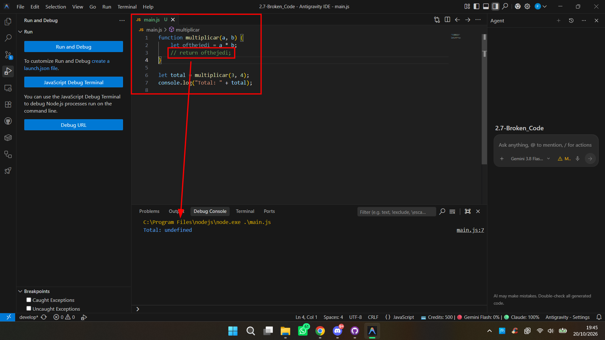

#### Depuración con Breakpoint e inspección de variables
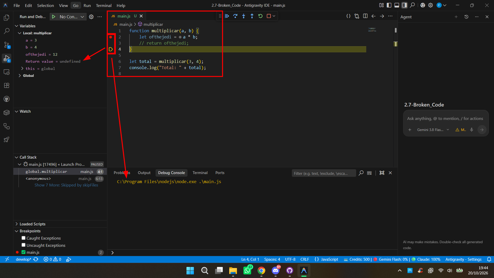

---

## Ejercicio 4: Names, names...

* **Dónde está el error:** En la instrucción `console.log("Hola " + name);` dentro de la función `saludar`. El parámetro recibido en la firma de la función se llama `nombre`, mientras que dentro del bloque se intenta acceder al identificador `name`, el cual no está definido en ese ámbito.
* **Tipo de error:** Error en tiempo de ejecución (*ReferenceError: name is not defined*).
* **Cómo corregirlo:** Cambiar `name` por el identificador del parámetro definido: `nombre` (`console.log("Hola " + nombre);`).
* **Código corregido:** [ejercicio4.js](src/ejercicio4.js)

### Evidencias de depuración

#### Ejecución del código con error
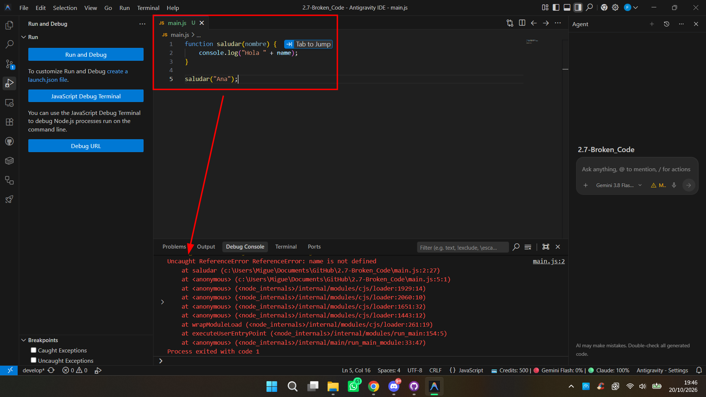

#### Depuración con Breakpoint e inspección de variables
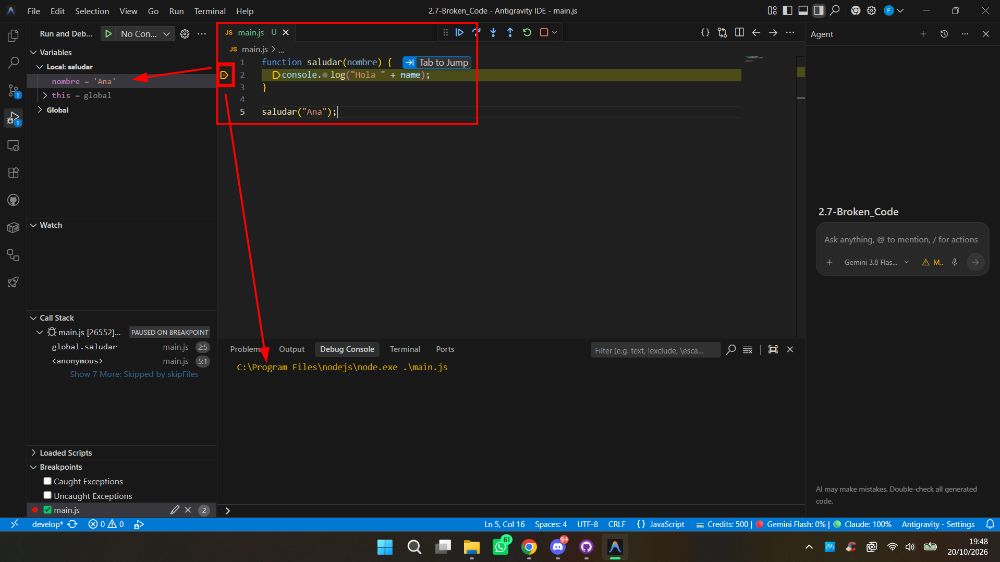

---

## Ejercicio 5: Out of control

* **Dónde está el error:** En la condición de continuidad del bucle `for` (`i <= numeros.length`). Los arrays en JavaScript tienen indexación base 0, por lo que para un array de longitud 4 los índices válidos van del 0 al 3. Al alcanzar `i = 4`, se intenta acceder a `numeros[4]`, lo que produce `undefined`. Al sumar un número con `undefined`, el acumulador se convierte en `NaN`.
* **Tipo de error:** Error lógico (desbordamiento de índice o fallo por uno / *off-by-one*).
* **Cómo corregirlo:** Modificar la condición del bucle a operador menor estricto: `i < numeros.length` (o `i <= numeros.length - 1`).
* **Código corregido:** [ejercicio5.js](src/ejercicio5.js)

### Evidencias de depuración

#### Ejecución del código con error
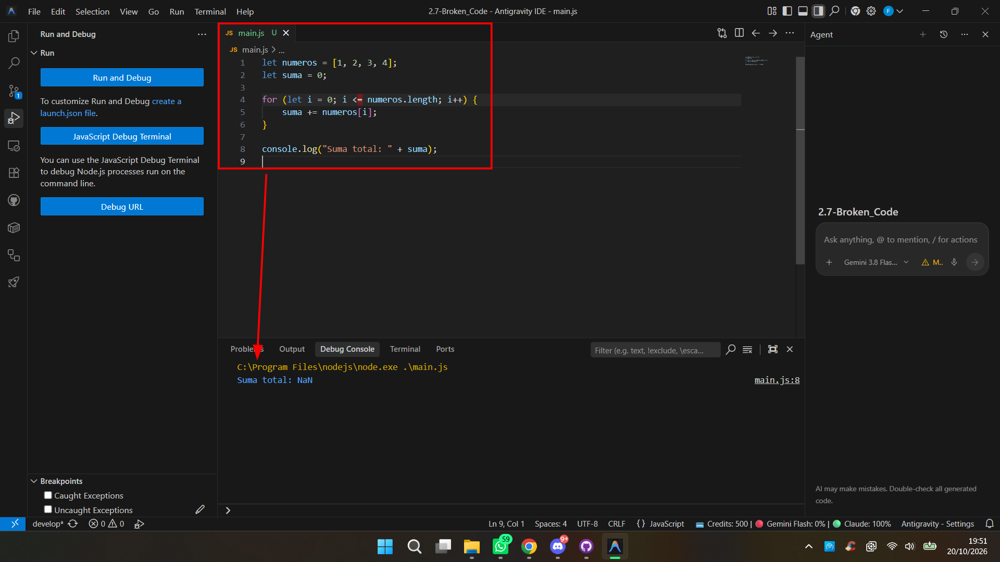

#### Depuración con Breakpoint e inspección de variables
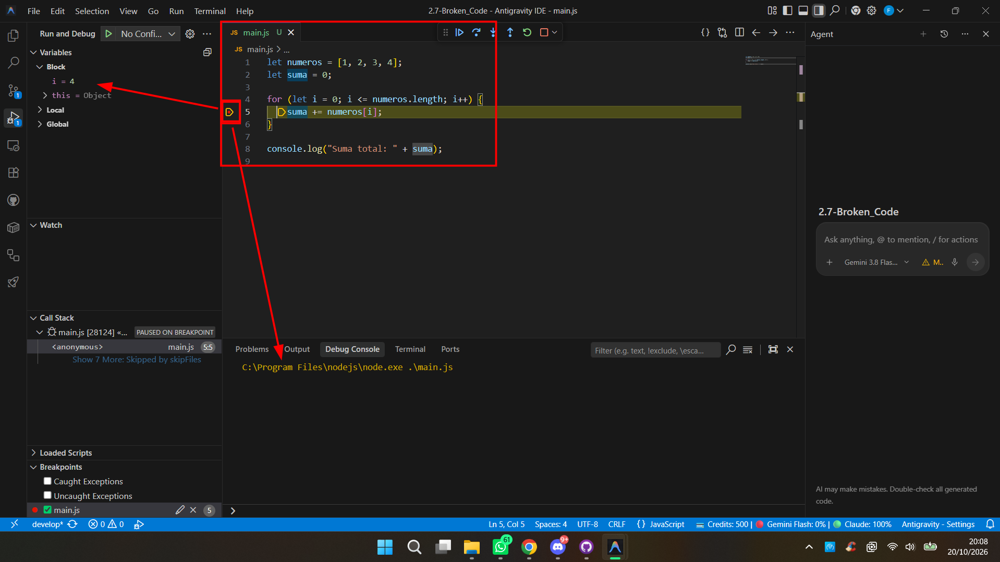

---

## Ejercicio 6: Usando expresiones

* **Dónde está el error:** En la condición del `if (num % 2 = 0)`. Se está utilizando el operador de asignación simple `=` en lugar de un operador de igualdad (`==` o `===`), intentando asignar un valor a una expresión aritmética.
* **Tipo de error:** Error sintáctico (*SyntaxError: Invalid left-hand side in assignment*).
* **Cómo corregirlo:** Reemplazar el signo de asignación por el operador de igualdad estricta: `if (num % 2 === 0)`.
* **Código corregido:** [ejercicio6.js](src/ejercicio6.js)

### Evidencias de depuración

#### Ejecución del código con error
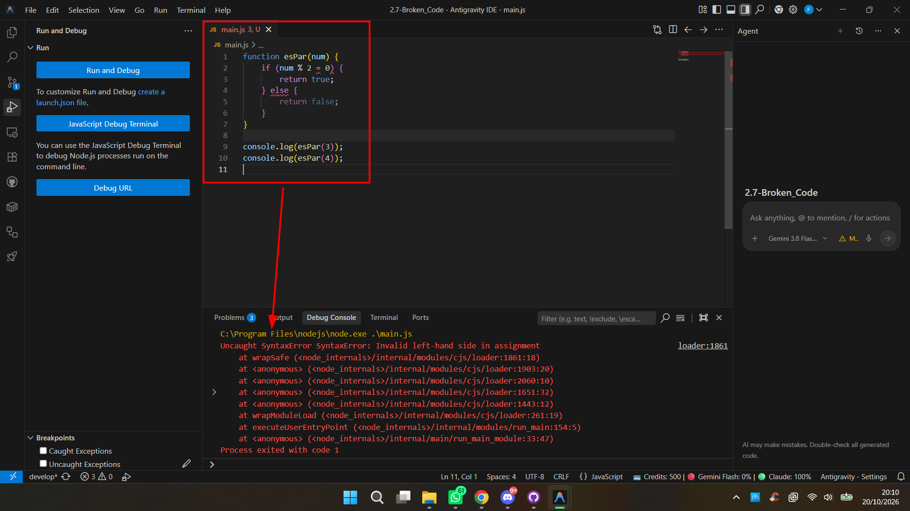

#### Depuración con Breakpoint e inspección de variables
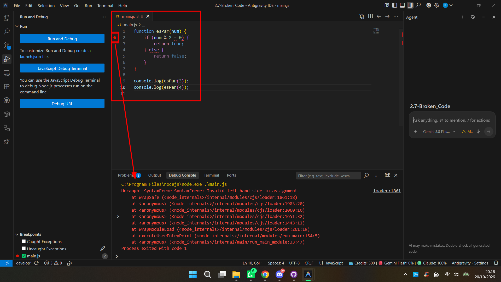

---

## Ejercicio 7: Callback defectuoso

* **Dónde está el error:** En la línea `callback(dat);` dentro de la función `procesarDatos`. El parámetro que contiene el array recibido es `datos`, pero se invoca el callback pasando una variable inexistente `dat`.
* **Tipo de error:** Error en tiempo de ejecución (*ReferenceError: dat is not defined*).
* **Cómo corregirlo:** Pasar el parámetro correcto a la llamada de la función de devolución: `callback(datos);`.
* **Código corregido:** [ejercicio7.js](src/ejercicio7.js)

### Evidencias de depuración

#### Ejecución del código con error
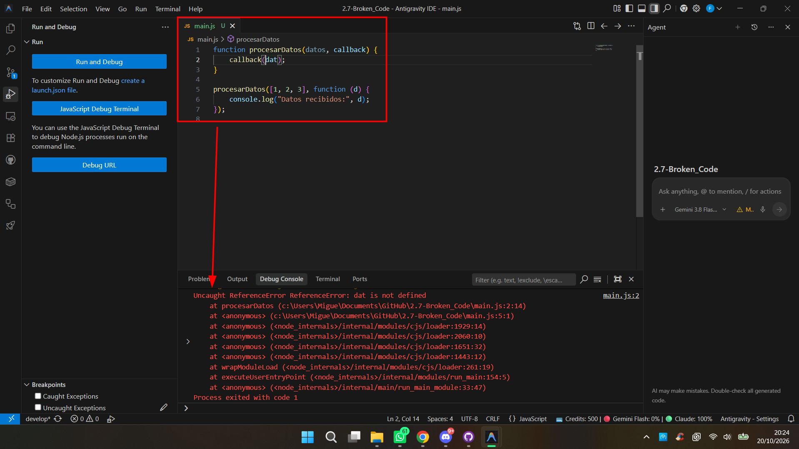

#### Depuración con Breakpoint e inspección de variables
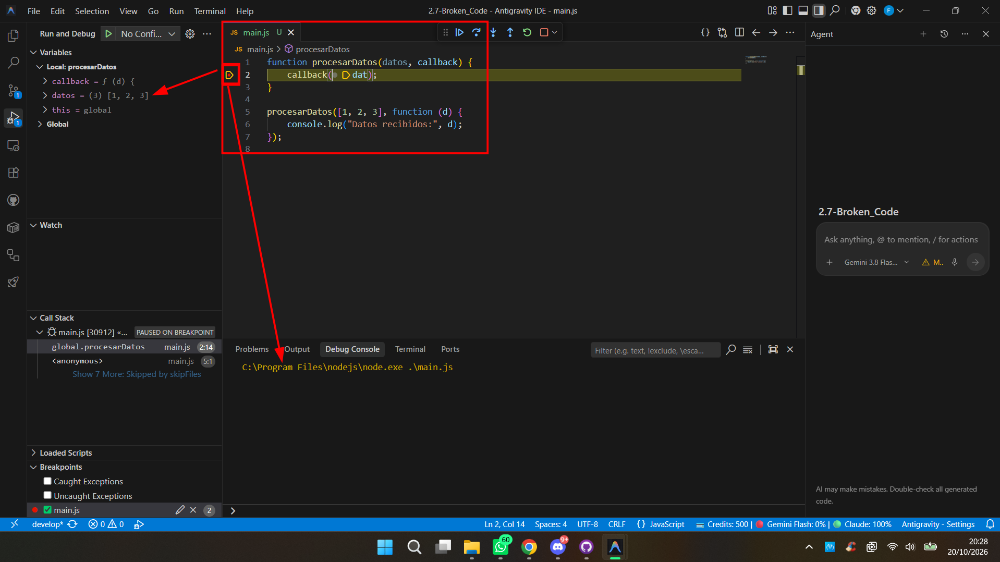

---

## Ejercicio 8: Evento click sospechoso

* **Dónde está el error:** En el manejador del evento `click`. Dentro de la función anónima se declara la variable `msg = "Hola mundo"`, pero luego se intenta imprimir `console.log(msj);`.
* **Tipo de error:** Error en tiempo de ejecución (*ReferenceError: msj is not defined* al dispararse el evento).
* **Cómo corregirlo:** Coincidir el nombre de la variable impresa con la variable declarada: `console.log(msg);`.
* **Código corregido:** [ejercicio8.html](src/ejercicio8.html) / [ejercicio8.js](src/ejercicio8.js)

### Evidencias de depuración

#### Ejecución del código con error
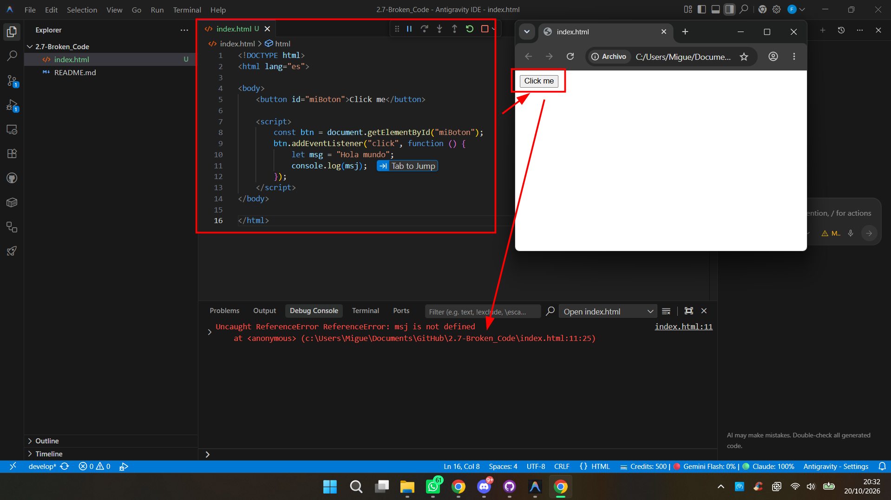

#### Depuración con Breakpoint e inspección de variables
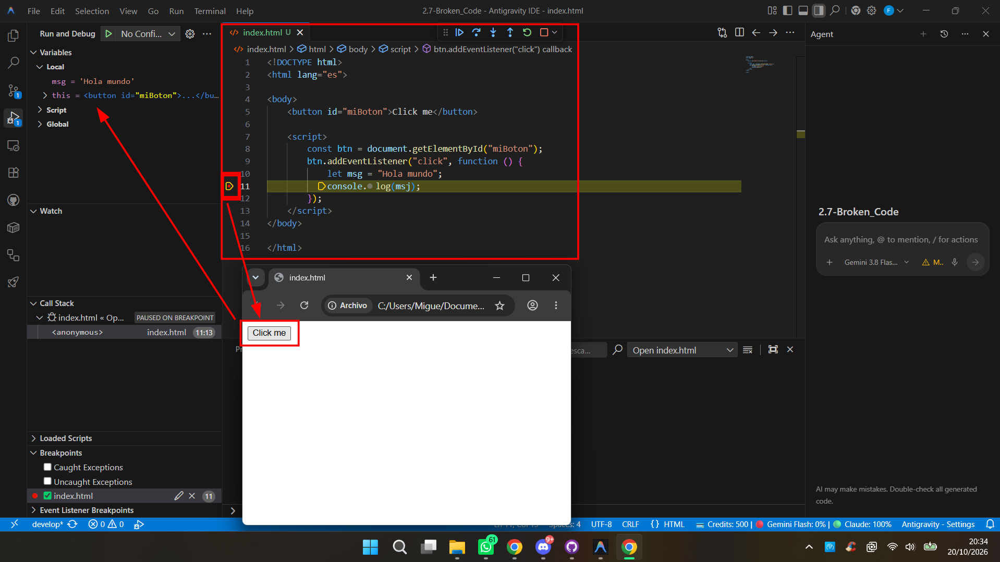

---

## Ejercicio 9: Cálculo misterioso

* **Dónde está el error:** En la lógica de interpretación del parámetro `descuento`. La función asume que el valor siempre se introduce en tanto por uno (por ejemplo, `0.2` para un 20%). Cuando un usuario introduce un porcentaje como número entero (por ejemplo, `60` para representar un 60%), la operación `base - base * descuento` calcula `100 - (100 * 60) = -5900`, resultando en un cálculo incoherente o erróneo.
* **Tipo de error:** Error lógico y de validación/normalización de datos de entrada ("error humano" de diseño al asumir un único formato de entrada).
* **Cómo corregirlo:** Normalizar el valor del descuento antes de aplicarlo. Si `descuento > 1`, se interpreta que se ha introducido un porcentaje y se divide entre 100 (`descuento = descuento / 100`) para convertirlo a tanto por uno. De este modo, la función opera correctamente tanto si se le pasa `0.2` como si se le pasa `60` (obteniendo en este último caso 40.00).
* **Código corregido:** [ejercicio9.js](src/ejercicio9.js)

### Evidencias de depuración

#### Ejecución del código con error
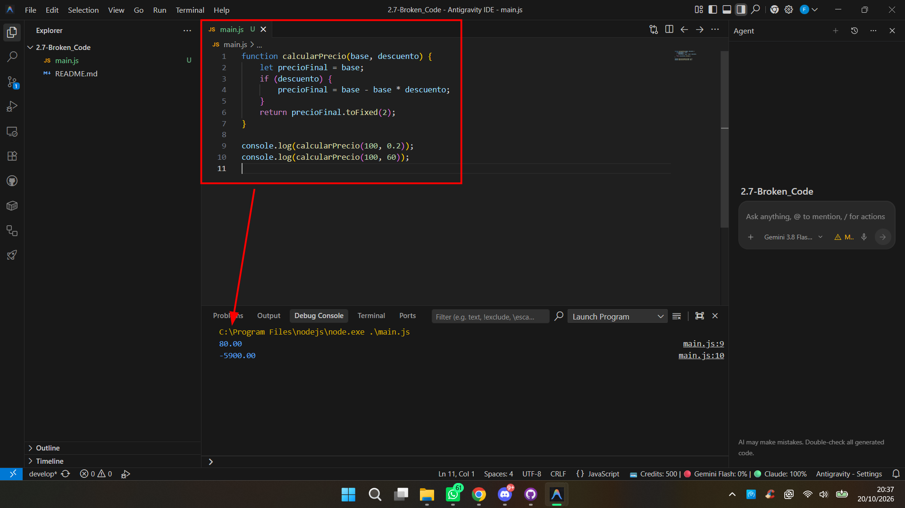

#### Depuración con Breakpoint e inspección de variables
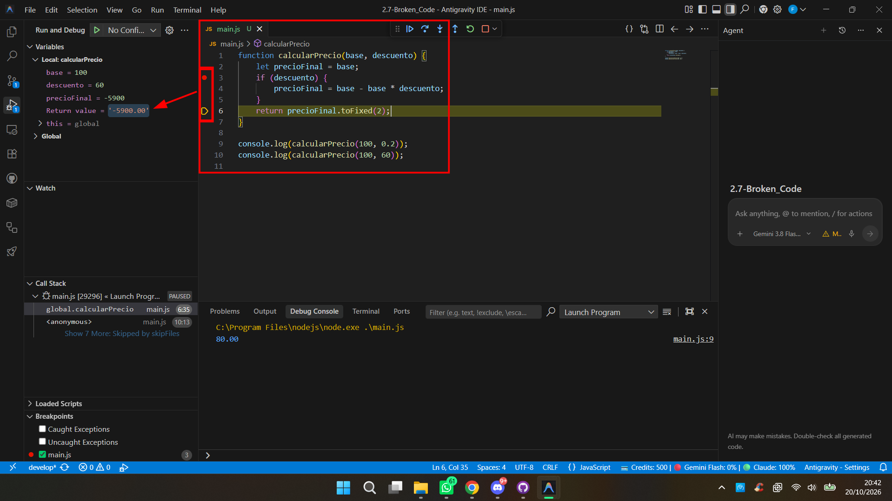
